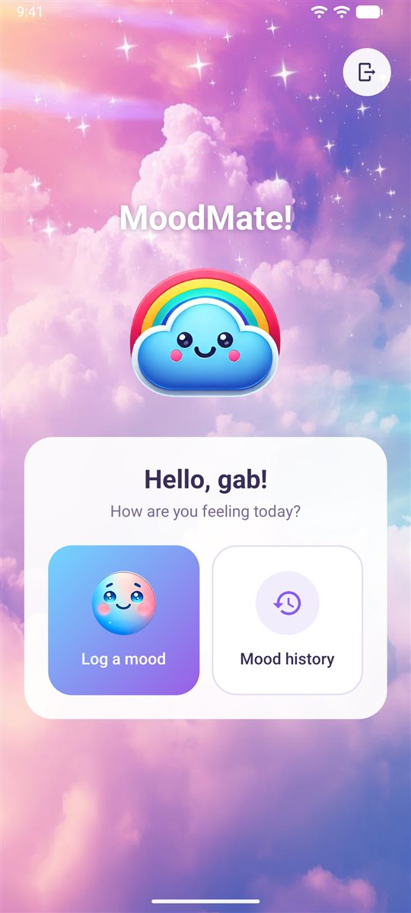
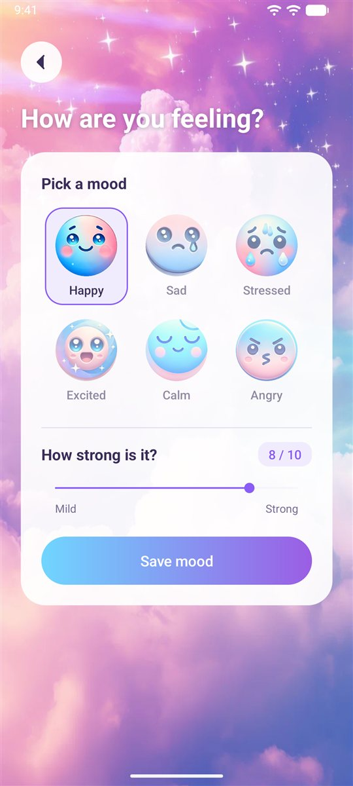
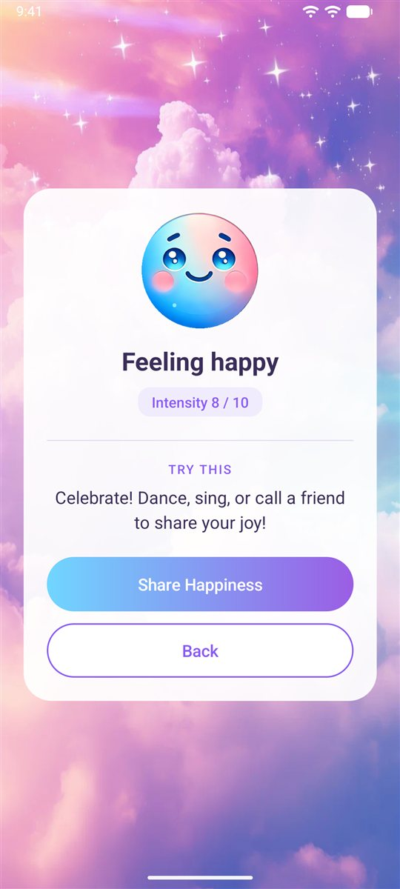
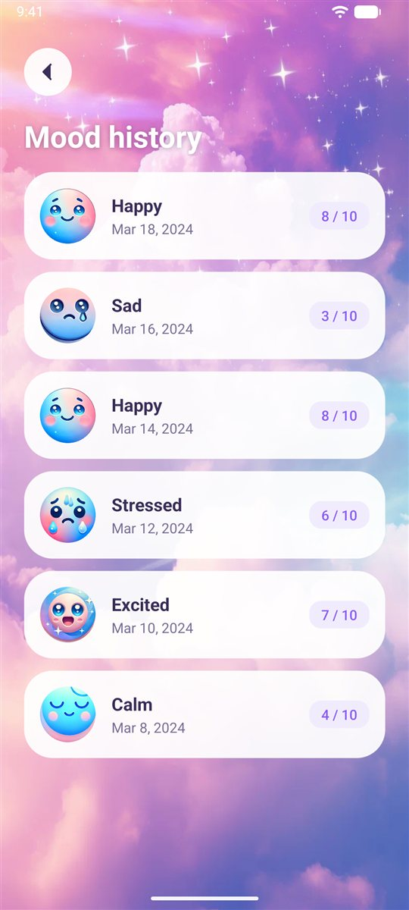

# MoodMate

A native Android app for checking in with how you feel. Pick one of six moods, rate how strong it is, and MoodMate responds with a suggestion, a one-tap quick action, and relaxing music when it helps. Every entry is saved, so you can look back on your mood history.

<p>
  
  
  
  
</p>

## Features

- **Six moods:** happy, sad, stressed, excited, calm, and angry
- **Intensity slider (0–10):** suggestions change with both the mood and how strong it is
- **Quick actions:** a one-tap action for each mood, such as Start Meditation or Do Deep Breathing
- **Relaxing music** that plays automatically for calm moods and strong sadness
- **Mood history:** past entries listed by date, newest first
- **Accounts:** sign-up and login with a strong-password check

## Tech stack

- **Kotlin**, native Android (minSdk 24, targetSdk 35)
- **Room** for mood entries, **SQLite** (`SQLiteOpenHelper`) for user accounts
- **Kotlin coroutines** to keep database work off the main thread
- Passwords stored as salted **PBKDF2** hashes, never in plain text

## Project structure

```
app/src/main/java/com/example/moodmate/
├── MainActivity.kt            Splash screen
├── LoginActivity.kt           Login
├── SignUpActivity.kt          Sign-up with password rules
├── HomeActivity.kt            Home: log a mood or view history
├── MoodSelectionActivity.kt   Pick a mood and its intensity
├── MoodSuggestionActivity.kt  Suggestion, quick action, and music
├── MoodTrackerActivity.kt     Mood history list
├── MoodEntry.kt / MoodDao.kt / MoodDatabase.kt   Room entity, queries, database
├── DatabaseHelper.kt          User accounts (SQLite)
├── PasswordHasher.kt          Salted PBKDF2 password hashing
└── MoodUi.kt                  Shared display helpers
```

## Run it

1. Open the project in **Android Studio**.
2. Let Gradle sync, then run the `app` configuration on an emulator or a device (Android 7.0+).

All data is stored locally on the device, so no backend or API keys are needed.

## Tests

- `./gradlew testDebugUnitTest`: unit tests for date formatting and mood icons
- `./gradlew connectedDebugAndroidTest`: on-device tests for password hashing (needs a running emulator or device)

## Background

In our second year, we came up with the idea for an app that lets people express their emotions, in response to rising rates of depression, anxiety, and suicide. We set out to combine mood tracking, personalized entertainment, and social connection in one app, so that instead of simply recording how they feel, users can take action based on it.

MoodMate was a two-person project for our App Development course. As lead developer, I focused on building the app in Android Studio. After the course, I refreshed the UI (readable card layouts, a consistent type and button style, cleaner mood icons, and a card-based history) and replaced plain-text password storage with salted hashing.

## Author

**Gabriel Bognot**: [GitHub](https://github.com/gabbogs) · [LinkedIn](https://www.linkedin.com/in/gabbogs/)
